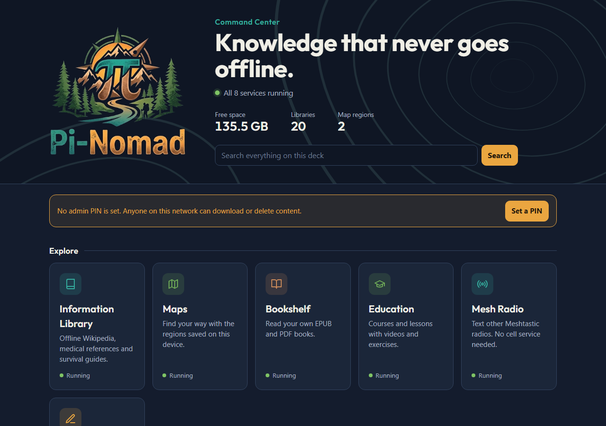
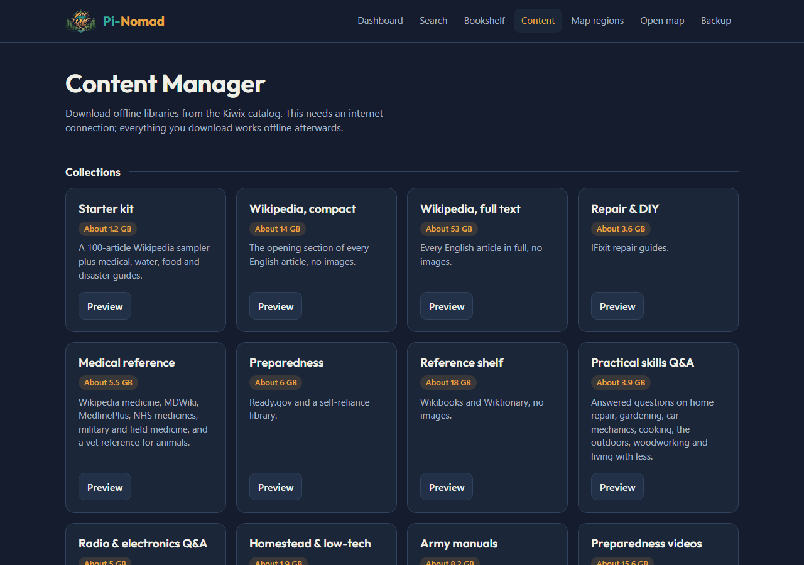
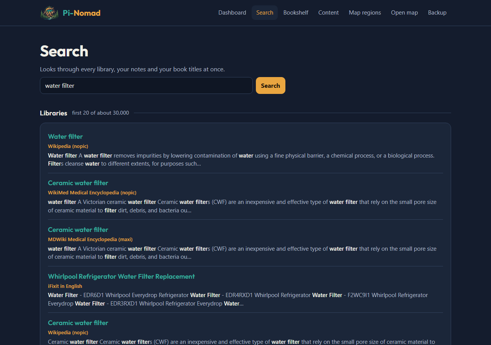

# Pi-NOMAD

**An offline knowledge server for a Raspberry Pi.** Wikipedia, medical references, repair guides, maps, your own books and notes, and a mesh radio, all in one box that works with no internet and no cell service. Phones and laptops connect to it over Wi-Fi and use it in a normal web browser.

It is built for a cyberdeck in a Pelican case, but any Raspberry Pi with 4 GB of memory will do. It is inspired by [Project NOMAD](https://github.com/Crosstalk-Solutions/project-nomad), without the AI chat, so it fits on a Pi.



## What's on it

| App | What it does |
|---|---|
| **Information Library** | Offline Wikipedia, medical encyclopedias, iFixit repair guides, survival and preparedness guides, and more, from the [Kiwix](https://kiwix.org) catalog. Pick from 12 ready-made collections or search the whole catalog. |
| **Search** | One box that searches every library, your notes and your book titles at once. |
| **Maps** | Offline street maps of any region you choose, with search for towns, streets and places. |
| **Bookshelf** | Your own EPUB and PDF books, with a built-in reader. |
| **Notes** | Simple notes you can write and search. |
| **Education** | Kolibri, for offline courses such as Khan Academy. |
| **Mesh Radio** | Text other [Meshtastic](https://meshtastic.org) radios with no cell service, and see them on the offline map. Needs a Meshtastic radio plugged in by USB. |
| **Comms tools** | Morse code with sound and light, emergency phrases in four languages, US radio frequencies worth knowing, and the spelling alphabet. |
| **Files** | Upload, download and manage everything on the drive. |
| **Data Tools** | CyberChef, for decoding, converting and checking data. |
| **Backup** | Copy your notes and books to a USB drive. |

The dashboard also shows temperature, memory, storage and power warnings, and has safe Shut down and Restart buttons.

| | |
|---|---|
|  |  |
| **Content Manager:** one-click collections | **Search:** every library at once |

## What you need

- **A Raspberry Pi with at least 4 GB of memory.** A Pi 5 is best. A Pi 400 also works; the first install just takes longer.
- **Storage:** a 128 GB or larger microSD card from a known brand (look for **A2** on the label), or better, an SSD. 64 GB works for a small setup without the big Wikipedia.
- **Raspberry Pi OS (64-bit)**, the Lite version is fine.
- **Internet, only while setting up** and downloading content. After that it runs fully offline.
- **Optional:** a Meshtastic radio such as a Heltec V3 or V4, for Mesh Radio.

See [How much space do I need](docs/GUIDE.md#how-much-space-do-i-need) for sizes.

## Install

1. **Prepare the Pi.** In [Raspberry Pi Imager](https://www.raspberrypi.com/software/), choose your Pi model and **Raspberry Pi OS Lite (64-bit)**. In the settings, set a hostname (for example `pi-nomad`), a username and password, your Wi-Fi, and turn on SSH. Write the card and start the Pi.

2. **Connect to it** from another computer:

   ```bash
   ssh your-username@pi-nomad.local
   ```

3. **Download Pi-NOMAD and install it:**

   ```bash
   sudo apt install -y git
   git clone https://github.com/redneck3d/Pi-Nomad.git
   cd Pi-Nomad
   sudo ./install.sh
   ```

   This installs Docker, downloads the apps and starts them. Expect 10 minutes or more, depending on your internet speed; part of it is built on the Pi itself, which is slower on a Pi 400.

4. **Open the dashboard** in a browser on the same network: `http://pi-nomad.local/` (use your hostname), or the Pi's IP address.

## First things to do

1. **Set an admin PIN** from the banner at the top of the dashboard. Without one, anyone on your network can download or delete content.
2. **Download content.** Open **Content** and start with the **Starter kit** (1.2 GB). Add more collections as space allows.
3. **Save a map region.** Open **Map regions**, pick your area, press **Estimate size**, then download it.
4. **Make it its own Wi-Fi network** so it works anywhere. See below.

## Use it with no internet (hotspot)

Pi-NOMAD can broadcast its own Wi-Fi network. Phones and laptops join it and open `http://10.42.0.1/`.

```bash
cd ~/Pi-Nomad
sudo ./hotspot.sh                  # turn it on (asks you to choose a Wi-Fi password)
sudo ./hotspot.sh password         # show the password you chose
sudo ./hotspot.sh off              # go back to your normal Wi-Fi
```

- **Plug in a network cable, or use a screen and keyboard, before you turn it on.** The hotspot takes over the Pi's Wi-Fi, so an SSH session over Wi-Fi will drop.
- It comes back on by itself after a restart, until you turn it off.
- Your phone may warn that the network has no internet. Tell it to stay connected.

## Updating

```bash
cd ~/Pi-Nomad
git pull
sudo ./install.sh
```

Your content, notes, maps and settings are kept. **Wait for downloads to finish first**, because the update restarts the dashboard and cancels the download queue.

## More help

- **[User guide](docs/GUIDE.md):** every feature in detail, storage sizes, moving to an SSD, the admin PIN, backup, Mesh Radio and troubleshooting.
- **[What has been tested](docs/TESTING.md):** what has been checked on real hardware, and what hasn't yet.
- **Found a problem?** [Open an issue](https://github.com/redneck3d/Pi-Nomad/issues) and say which Pi you have and what you saw.

## Security

There are no logins on most of the apps, on purpose, so anyone on the deck's network can read everything. The admin PIN protects downloads, deletes and power buttons on the dashboard, but **the Files app can still change or delete anything**. Keep Pi-NOMAD on its own hotspot or your home network, and **never expose it to the internet.**

## Licence

Pi-NOMAD is free to use, change and share for **non-commercial** purposes under the [PolyForm Noncommercial License 1.0.0](LICENSE.md). Personal use, hobby projects, schools, charities, emergency services and other non-profit organisations are all fine. **Selling it, or selling devices with it installed, is not allowed** without written permission from the author, Michael P.

The apps Pi-NOMAD installs are separate projects with their own licences. They are downloaded from their makers during install, not included in this repository:

| Project | Licence |
|---|---|
| [Kiwix](https://github.com/kiwix/kiwix-tools) (Information Library) | GPL-3.0 |
| [Kolibri](https://github.com/learningequality/kolibri) (Education) | MIT |
| [MeshMonitor](https://github.com/yeraze/meshmonitor) (Mesh Radio) | BSD-3-Clause |
| [flatnotes](https://github.com/dullage/flatnotes) (Notes) | MIT |
| [CyberChef](https://github.com/gchq/CyberChef) (Data Tools) | Apache-2.0 |
| [Dufs](https://github.com/sigoden/dufs) (Files) | Apache-2.0 |
| [MapLibre GL JS](https://github.com/maplibre/maplibre-gl-js), [Protomaps](https://github.com/protomaps) (Maps) | BSD-3-Clause |
| [Outfit](https://fonts.google.com/specimen/Outfit) font | SIL Open Font License |

Map data is © [OpenStreetMap](https://www.openstreetmap.org/copyright) contributors. Library content belongs to its publishers; each library lists its own licence in Kiwix.

Pi-NOMAD is not affiliated with Project NOMAD, Kiwix, Meshtastic or Raspberry Pi.
