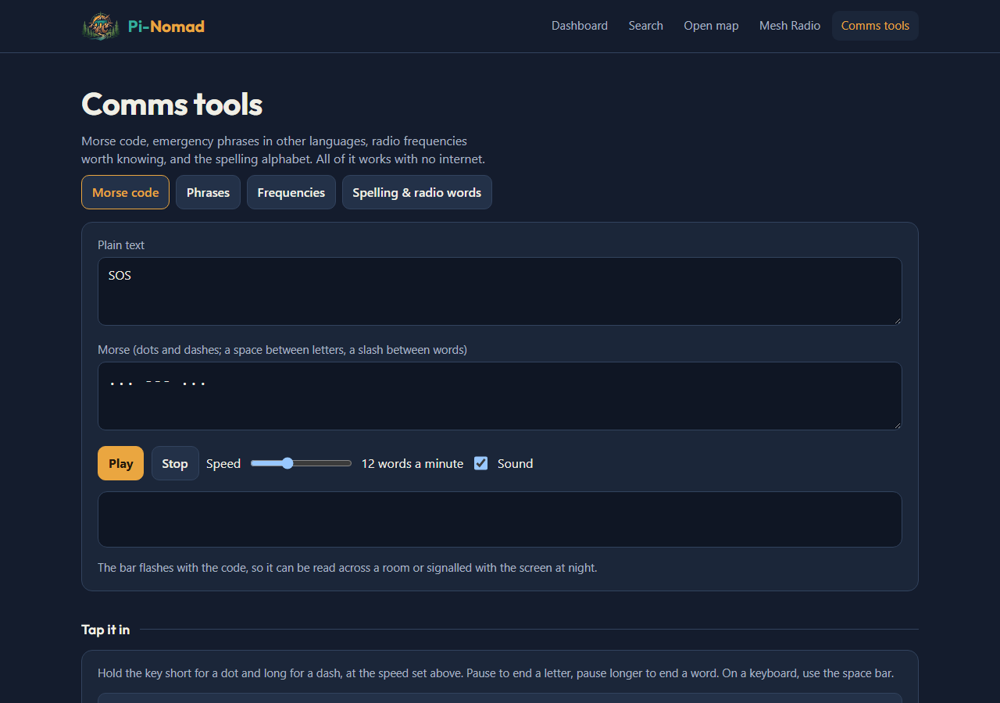

# Pi-NOMAD user guide

Everything Pi-NOMAD does, in more detail than the [README](../README.md). Commands below are run on the Pi, in the folder you installed from (for example `~/Pi-Nomad`).

- [The dashboard](#the-dashboard)
- [Adding libraries](#adding-libraries)
- [How much space do I need](#how-much-space-do-i-need)
- [Search](#search)
- [Maps](#maps)
- [Bookshelf](#bookshelf)
- [Notes and Files](#notes-and-files)
- [Education (Kolibri)](#education-kolibri)
- [Mesh Radio (Meshtastic)](#mesh-radio-meshtastic)
- [Comms tools](#comms-tools)
- [Admin PIN](#admin-pin)
- [Backup](#backup)
- [Starting and stopping apps](#starting-and-stopping-apps)
- [Shut down and restart](#shut-down-and-restart)
- [Hotspot](#hotspot)
- [Moving to an SSD (Pi 5)](#moving-to-an-ssd-pi-5)
- [Where things are kept](#where-things-are-kept)
- [Troubleshooting](#troubleshooting)

## The dashboard

Open `http://<hostname>.local/`, or `http://10.42.0.1/` on the hotspot. It shows a tile for each app with whether it is running, free space, how many libraries and map regions are installed, and a System panel with temperature, memory, uptime, drive writes and warnings for heat, low voltage or a wrong clock.

Each app opens under a small Pi-NOMAD bar, so there is always a way back to the dashboard. Education opens in its own tab.

## Adding libraries

Open **Content** on the dashboard. You need internet for this part only.

- **Collections** are ready-made sets: Starter kit, two sizes of Wikipedia, Repair & DIY, Medical reference, Preparedness, Reference shelf, Practical skills Q&A, Radio & electronics Q&A, Homestead & low-tech, Army manuals and Preparedness videos. Each shows its size. **Preview** lists what is in it before you download.
- **Search the catalog** to find any single library Kiwix publishes, in any language.
- Downloads run one at a time, **resume by themselves** if the connection drops, refuse to start if the drive would fill up, and are checked against the checksum Kiwix publishes. Each library appears in the Information Library as soon as it finishes.
- **Delete** removes a library and frees its space.
- Already have `.zim` files? Copy them into the `zim` folder with the Files app, then press **Rescan folder**.

Some very large libraries are left out on purpose because they don't fit a typical deck, for example Project Gutenberg (221 GB).

## How much space do I need

The system and apps use about 10 GB. Rough sizes of the content:

| Content | Size |
|---|---|
| Starter kit | 1.2 GB |
| Wikipedia, compact (opening section of every article) | 14 GB |
| Wikipedia, full text, no pictures | 53 GB |
| Wikipedia with pictures (catalog search, not a collection) | 127 GB |
| Other collections | about 2 to 18 GB each |
| A metro area, overview detail (Detroit) | 2.5 MB |
| A whole state, full detail (Michigan) | 1.1 GB |

So a **128 GB** card fits the compact Wikipedia, most collections and some maps; **256 GB** fits the full-text Wikipedia and everything else with room to spare.

Tips for SD cards:

- Buy from a known brand and a trusted seller; fake large cards are common.
- Back up your notes and books now and then. Cards fail without warning.
- The dashboard's Storage panel shows what is using the space.

## Search

The search box on the dashboard, or the **Search** page, looks through every library, your notes and your book titles at once. Anything you install is searchable straight away. The text inside your own books is not searched, only titles and authors.

## Maps

- **Map regions** saves a region for offline use. Pick a region from the list, or **Custom area** and type its west, south, east and north edges in degrees. Choose the detail (Overview, Standard or Detailed), press **Estimate size** to see how big it will be, then **Download region**. It cuts your region out of the worldwide [Protomaps](https://protomaps.com) map, so it needs internet while downloading.
- **Open map** shows saved regions with no internet. The search box finds towns, streets, highways, parks, lakes and other named places. Streets are listed nearest first, and short forms work (`main st`, `mt clemens`). There are no house numbers, so it finds the street but not the address.
- You can also copy any `.pmtiles` map file into the `maps` folder.

## Bookshelf

Put EPUB and PDF files in the `books` folder (subfolders are fine), with the Files app or by copying them onto the drive. They appear on the **Bookshelf**.

- EPUBs open in the built-in reader: chapter list, text size, light, sepia and dark, and it remembers your place on each device.
- PDFs open in the browser's own viewer.
- Covers come from inside the EPUB, or from a JPG or PNG with the same name as the book anywhere in the books folder.
- Books with DRM (copy protection) won't open.

## Notes and Files

- **Notes** ([flatnotes](https://github.com/dullage/flatnotes)) keeps simple Markdown notes. They are included in search and backup.
- **Files** ([Dufs](https://github.com/sigoden/dufs)) shows everything on the data drive: browse, upload, download, delete. It has no login, so anyone on the network can change things there.
- A note uploaded through Files can be read in Notes but not edited until the deck is restarted.

## Education (Kolibri)

[Kolibri](https://learningequality.org/kolibri/) is an offline learning platform with courses such as Khan Academy. The first time you open it, it walks you through setup and has you create its own admin account (separate from the admin PIN).

Lessons are added from inside Kolibri, while you have internet or from a USB drive. They are large (tens of GB for all of Khan Academy), so pick subjects. Kolibri's data is not part of the USB backup.

## Mesh Radio (Meshtastic)

1. Fit the antenna to your Meshtastic radio **before** powering it. Running a radio without its antenna can damage it.
2. Plug the radio into one of the Pi's USB ports.
3. Open **Mesh Radio** on the dashboard.

It is [MeshMonitor](https://github.com/yeraze/meshmonitor): messages, the list of radios heard, and their details. It has its own login: the first time it is `admin` / `changeme`, and it asks you to change it. **Change it.**

- The radio can be unplugged and plugged back in while the deck is running.
- Radios that share their position are shown on the deck's offline **Map**, with a **Mesh radios** button to hide them. Tap one for its name, hops and battery. (MeshMonitor's own map needs internet.)
- Radios from USB makers Espressif, Silicon Labs, WCH, Adafruit and Seeed are recognised, which covers Heltec, LilyGO, RAK and Seeed boards.

## Comms tools

The **Comms tools** page runs entirely in the browser:



- **Morse code** both ways, with sound, a flashing bar you can signal with, and a tap key.
- **Phrases**: emergency phrases in Spanish, French, German and Italian, with a button to speak them. They have not been checked by a native speaker.
- **Frequencies**: CB, FRS/GMRS, MURS, NOAA weather, ham calling, marine and air emergency, and Meshtastic, for the US.
- **Spelling and radio words**: the NATO alphabet with a speller, and common radio words such as Mayday and Pan-pan.

## Admin PIN

Set a PIN from the banner at the top of the dashboard. Everyone can still read everything, but downloading, deleting, backup, starting and stopping apps and the power buttons ask for the PIN. An unlocked device stays unlocked for 12 hours or until you press **Lock**. Repeated wrong tries cause a growing pause.

**Forgot it?** On the Pi:

```bash
cd /opt/pi-nomad
sudo docker compose exec command-center python auth.py reset
```

Then set a new one from the dashboard.

The PIN is a light lock for a private network, not real security. It does not cover Files, Notes, Kolibri or Mesh Radio, and traffic is plain HTTP, so it is only as private as your Wi-Fi password.

## Backup

The **Backup** page copies your notes and books to a USB drive plugged into the Pi, into a dated folder called `pi-nomad-backup`. It can also download your notes as a zip to the phone or computer you are using.

Libraries and maps are not copied, because they can be downloaded again; every backup includes `installed-content.txt`, a list of them. Mesh Radio and Kolibri data are not included yet.

**To restore:** upload the `notes` and `books` folders back through the Files app, then press **Restart** on the dashboard.

## Starting and stopping apps

The Apps panel on the dashboard can stop, start or restart the Library, Notes, Data Tools, Files, Education and Mesh Radio. A stopped app stays off, even after a restart, until you press Start. Stopping apps you don't use frees memory.

## Shut down and restart

Use **Shut down** on the dashboard before cutting the power, so the card isn't damaged. After a shut down the Pi stays off until power is reconnected or, on a Pi 5, its power button is pressed.

## Hotspot

```bash
sudo ./hotspot.sh                  # on, named Pi-NOMAD (asks you to choose a Wi-Fi password)
sudo ./hotspot.sh "My Deck"        # on, with a different network name
sudo ./hotspot.sh password         # show the Wi-Fi password
./hotspot.sh status                # is it on?
sudo ./hotspot.sh off              # off, back to your normal Wi-Fi
```

On the hotspot the deck is always at `http://10.42.0.1/`. Use a network cable or a screen and keyboard when turning it on or off, since it takes over the Pi's Wi-Fi.

If you run more than one deck, give each hotspot a different name.

## Moving to an SSD (Pi 5)

A Pi 5 with an NVMe SSD (on an M.2 HAT) is faster and avoids SD card wear. `tools/move-to-ssd.sh` copies the whole deck, system and content, onto the SSD and sets it to boot from there:

```bash
./tools/move-to-ssd.sh --check     # shows what would happen, changes nothing
sudo ./tools/move-to-ssd.sh        # ERASES the SSD and copies everything onto it
```

It asks you to type `ERASE` before it starts. The apps stop while it copies. The SD card is only read, never changed. Then shut down, take the SD card out and power on. Keep the old card as a spare: put it back in and the Pi boots from it as before. The script only works with NVMe drives; it won't move a Pi 400 to a USB drive.

## Where things are kept

| What | Where on the Pi |
|---|---|
| Libraries (`.zim`) | `/srv/nomad/zim` |
| Maps (`.pmtiles`) | `/srv/nomad/maps` |
| Notes | `/srv/nomad/notes` |
| Books | `/srv/nomad/books` |
| Kolibri | `/srv/nomad/kolibri` |
| Mesh Radio | `/srv/nomad/mesh` |
| Installed app settings | `/opt/pi-nomad` |

The apps also answer on their own ports: Library 8080, Notes 8081, Data Tools 8082, Files 8083, Education 8085, Mesh Radio 8087.

## Troubleshooting

**`pi-nomad.local` doesn't open.** Use the Pi's IP address instead (shown in your router's device list). Some Android phones and Windows PCs don't find `.local` names.

**My phone says the hotspot password is wrong.** Run `sudo ./hotspot.sh password` to see the real one. On the phone, choose **Forget this network**, then join again. Since 2026-11-16 the hotspot also turns off a security option that made iPhones refuse to join; if you set up the hotspot before then, run `sudo ./hotspot.sh` again.

**An app tile says it isn't running.** Press **Start** in the Apps panel. If it stops again, look at its log:

```bash
cd /opt/pi-nomad
sudo docker compose logs --tail 50 kiwix
```

(the names are `command-center`, `kiwix`, `flatnotes`, `cyberchef`, `files`, `kolibri`, `meshmonitor` and `mesh-bridge`).

**A download stopped.** Downloads resume after short drops. If one fails, press download again: it carries on from where it stopped.

**Mesh Radio shows no radio.** Check the antenna and the USB cable (some cables carry power only). Unplug and plug the radio back in; it should be found within a minute.

**Everything is slow.** Check the System panel for heat or low-voltage warnings. Use the official power supply; a weak one causes slowdowns and card damage.
